  

# 🚀 Awesome Operating System For Business / All-In-One SaaS

**A curated list of elite Business Operating Systems (BOS), unified All-in-One SaaS platforms, Enterprise Resource Planning (ERP) solutions, and modern self-hosted open-source alternatives.**

*Manage finance, accounting, CRM, human resources, projects, inventory, customer support, and AI-native automation workflows from a consolidated operational command center.*

🌟 **Star this repository if you find it valuable!** 🌟

---

## 🧭 Quick Navigation & Table of Contents

- [🌐 Sector Overview & Market Dynamics](#-sector-overview--market-dynamics)
- [☁️ SaaS / Hosted Commercial Platforms](#-saas--hosted-commercial-platforms)
- [🔓 Open-Source Software & Self-Hosted Platforms](#-open-source-software--self-hosted-platforms)
- [📊 Feature Comparison Matrix](#-feature-comparison-matrix)
- [⭐ Star History](#-star-history)
- [💖 Support & Sponsorship](#-support--sponsorship)
- [🤝 Contributing](#-contributing)
- [📄 License](#-license)

---

## 🌐 Sector Overview & Market Dynamics

The global Business Operating System (BOS), ERP, and unified enterprise software market is valued at approximately **$185 Billion+** and is projected to surpass **$300 Billion+ by 2030** with an annual growth rate (CAGR) of 10–12%. The market exhibits a **moderately fragmented, dual-tier structure**: massive hyperscalers and legacy enterprise conglomerates dominate high-end Fortune 500 financials and enterprise productivity (winner-take-most in enterprise tier), while mid-market businesses and SMBs are fiercely fragmented and rapidly adopting agile modular all-in-one SaaS suites and extensible, self-hosted open-source business OS platforms with deep AI/MCP agent capabilities.

---

## ☁️ SaaS / Hosted Commercial Platforms

Commercial, cloud-hosted Operating System for Business / All-in-One SaaS suites ranked by company scale (market capitalization/valuation or annual revenue).

| Rank | Platform | Company Scale (Valuation / Revenue) | Starting Pricing (Specific Tier) | Free Tier / Trial Limit | Core Modules Included | Best For |
|:---:|---|---|---|---|---|---|
| 1️⃣ | **[Microsoft 365](https://www.microsoft.com/microsoft-365)** | ~$3.1 Trillion Market Cap (~$245B ARR) | $6.00/user/month (Business Basic, annual commitment) | 30-day free trial (Full Business Standard suite, up to 25 user licenses) | Productivity, Teams, Exchange, SharePoint, OneDrive, Power Platform | Organizations standardized on Microsoft seeking productivity & low-code automation |
| 2️⃣ | **[Google Workspace](https://workspace.google.com/)** | ~$2.2 Trillion Market Cap (~$307B ARR) | $6.00/user/month (Business Starter, 1-year commitment) | 14-day free trial (Business Starter/Standard features, up to 10 users) | Gmail, Calendar, Drive, Docs, Meet, Sheets, AppSheet | Cloud-first agile teams requiring best-in-class real-time collaboration |
| 3️⃣ | **[NetSuite](https://www.netsuite.com/)** | ~$350 Billion Oracle Market Cap (~$53B ARR) | $999.00/month base platform fee + $99.00/user/month | 14-day guided product tour & demo sandbox (custom sample enterprise dataset) | Cloud ERP, GL Financials, Revenue Management, Advanced Inventory, CRM | Mid-market to hyper-growth enterprises requiring multi-subsidiary global ERP |
| 4️⃣ | **[Workday](https://www.workday.com/)** | ~$70 Billion Market Cap (~$7.3B ARR) | ~$100.00/employee/month (Core HCM/Financials starting baseline) | 30-day guided enterprise test environment (sales-assisted, sandbox data limit) | Enterprise HCM, Payroll, Financial Management, Planning, Talent Intelligence | Large-scale enterprises needing unified human capital and financial planning |
| 5️⃣ | **[Odoo Enterprise](https://www.odoo.com/)** | ~$5 Billion Valuation (~$350M+ ARR) | $24.90/user/month (Standard Plan, billed annually) | Free forever for exactly 1 app (unlimited users on Odoo Cloud); 15-day free trial on multi-app standard | Full modular ERP, Accounting, Inventory, CRM, eCommerce, POS, Studio | Growing businesses wanting all-in-one modular breadth with modern UI |
| 6️⃣ | **[Zoho One](https://www.zoho.com/one/)** | ~$1.2 Billion+ Annual Revenue (Privately Held) | $37.00/employee/month (All-Employee pricing model, billed annually) | 30-day free trial (Full access to 45+ enterprise apps, no credit card required) | 45+ unified apps: CRM, Books, Desk, Projects, People HR, Campaigns, Analytics | SMBs desiring total operational software unification under a single predictable subscription |
| 7️⃣ | **[Bitrix24](https://www.bitrix24.com/)** | ~$100 Million+ Annual Revenue (Bootstrapped/Private) | $49.00/month total for entire organization (Basic Plan, 5 users, billed annually) | Free forever plan: 100% free for unlimited users with 5 GB cloud storage & standard CRM | CRM, Team Chat, Video Conferencing, Task/Project Management, Drive, CoPilot AI | Small teams and agencies looking for free unlimited user seats and CRM pipeline |

---

## 🔓 Open-Source Software & Self-Hosted Platforms

Production-ready, self-hosted, community-driven Operating System for Business solutions and ERP engines. Each repository features live stargazers metrics linking directly to its GitHub repository stargazers page, ordered in descending order by GitHub_Stars.

| Rank | Project | GitHub_Stars (Live Badge) | Technology Stack | License | Core Capabilities |
|:---:|---|:---:|---|---|---|
| 1️⃣ | **[Twenty](https://twenty.com/)** |  | TypeScript, Node.js, React, PostgreSQL | AGPL-3.0 | Modern CRM and business operation foundation, extensible data models, Kanban pipelines, self-hostable alternative to Salesforce. |
| 2️⃣ | **[Odoo Community](https://www.odoo.com/)** |  | Python, JavaScript, PostgreSQL | LGPL-3.0 | World-class modular open-source ERP with CRM, sales, billing, inventory, manufacturing, HR, and thousands of community modules. |
| 3️⃣ | **[ERPNext](https://erpnext.com/)** |  | Python, Frappe Framework, MariaDB | GPL-3.0 | Full-featured 100% open-source ERP covering double-entry accounting, payroll, supply chain, asset lifecycle, CRM, and shop-floor manufacturing. |
| 4️⃣ | **[Krayin CRM](https://krayincrm.com/)** |  | PHP, Laravel, MySQL / MariaDB | MIT | Enterprise-grade Laravel CRM and lead management platform with custom attribute builders, kanban pipelines, and REST APIs. |
| 5️⃣ | **[AureusERP](https://aureuserp.com/)** |  | PHP, Laravel, FilamentPHP, MariaDB | MIT | Modern modular ERP platform built on FilamentPHP for accounting, invoicing, warehouse stock, recruitment, and project delivery. |
| 6️⃣ | **[Invoice Ninja](https://invoiceninja.com/)** |  | PHP, Laravel, Flutter, MySQL | Elastic License 2.0 | Complete financial invoicing engine, recurring billing, client portals, expense tracking, quotes, and payment gateway integrations. |
| 7️⃣ | **[Dolibarr ERP CRM](https://www.dolibarr.org/)** |  | PHP, MySQL / PostgreSQL | GPL-3.0 | Lightweight, easy-to-deploy modular ERP/CRM suite for SMBs, freelancers, and foundations covering orders, invoices, contracts, and POS. |
| 8️⃣ | **[SuiteCRM](https://suitecrm.com/)** |  | PHP, Symfony, Angular, MariaDB | AGPL-3.0 | Enterprise-ready CRM platform with workflow automation, sales pipelines, customer service helpdesk, and marketing campaigns. |
| 9️⃣ | **[EspoCRM](https://www.espocrm.com/)** |  | PHP, Backbone.js, MySQL / MariaDB | AGPL-3.0 | Highly responsive web-based CRM with custom entity managers, sales pipelines, email client sync, calendar, and REST API. |
| 🔟 | **[Apache OFBiz](https://ofbiz.apache.org/)** |  | Java, Apache Tomcat, PostgreSQL | Apache-2.0 | Battle-tested Apache foundation enterprise framework for accounting, supply chain execution, warehouse management, and ERP logic. |
| 1️⃣1️⃣ | **[Tryton](https://www.tryton.org/)** |  | Python, GTK, PostgreSQL | GPL-3.0 | Highly modular three-tier business software suite covering financial accounting, analytical accounting, inventory, and analytics. |
| 1️⃣2️⃣ | **[Atlas](https://github.com/gorkem-bwl/atlas)** |  | TypeScript, Next.js, PostgreSQL | MIT | Modern self-hosted business platform with CRM, HRM, invoices, tasks, drive, e-signatures, and built-in Odoo migration tool. |
| 1️⃣3️⃣ | **[FlowWink](https://github.com/magnusfroste/flowwink)** |  | TypeScript, Supabase, React | Apache-2.0 | AI-native autonomous business operating system exposing 500+ MCP capabilities for Claude, OpenClaw, and autonomous AI agents. |
| 1️⃣4️⃣ | **[TropaTT](https://github.com/Anton-Barinov/TropaTT)** |  | PHP, MySQL | AGPL-3.0 | Self-hosted business OS integrating CRM, task management, team chat, 984 core API endpoints, and 621 MCP tools for AI workflows. |

---

## 📊 Feature Comparison Matrix

| Software / Solution | Deployment | Accounting & Finance | CRM & Sales | HR & Payroll | Projects & Tasks | AI & MCP Tools | Target Segment |
|---|:---:|:---:|:---:|:---:|:---:|:---:|---|
| **Microsoft 365** | ☁️ Cloud SaaS | ⚠️ (Add-on) | ⚠️ (Dynamics) | ⚠️ (Viva) | ✅ | ✅ (Copilot) | Enterprise productivity & hybrid work |
| **Google Workspace** | ☁️ Cloud SaaS | ❌ | ❌ | ❌ | ⚠️ (Tasks) | ✅ (Gemini) | Agile collaboration & cloud communication |
| **NetSuite** | ☁️ Cloud SaaS | ✅ | ✅ | ✅ | ✅ | ✅ (SuiteAnalytics) | Mid-market to enterprise global ERP |
| **Workday** | ☁️ Cloud SaaS | ✅ | ❌ | ✅ | ✅ | ✅ (Workday AI) | Enterprise HCM, payroll & financials |
| **Odoo Enterprise** | ☁️ Cloud / Hybrid | ✅ | ✅ | ✅ | ✅ | ✅ (AI Studio) | SMB to scaling enterprises |
| **Zoho One** | ☁️ Cloud SaaS | ✅ | ✅ | ✅ | ✅ | ✅ (Zia AI) | SMBs wanting all-in-one suite breadth |
| **Bitrix24** | ☁️ Cloud / On-Prem | ⚠️ (Invoicing) | ✅ | ✅ | ✅ | ✅ (CoPilot AI) | Small to midsize teams & agencies |
| **Twenty** | 🔓 Self-Hosted / Cloud | ❌ | ✅ | ❌ | ✅ | ✅ (API/Webhooks) | Modern developer-friendly CRM & sales ops |
| **Odoo Community** | 🔓 Self-Hosted | ✅ | ✅ | ✅ | ✅ | ⚠️ (Via Modules) | Modular open-source ERP standard |
| **ERPNext** | 🔓 Self-Hosted / Cloud | ✅ | ✅ | ✅ | ✅ | ⚠️ (Frappe AI) | Full-featured 100% open-source ERP |
| **Krayin CRM** | 🔓 Self-Hosted | ❌ | ✅ | ❌ | ⚠️ (Activities) | ⚠️ (REST API) | Laravel-centric CRM and lead management |
| **AureusERP** | 🔓 Self-Hosted | ✅ | ✅ | ✅ | ✅ | ⚠️ (Filament AI) | Modern MIT Laravel/Filament ERP |
| **Invoice Ninja** | 🔓 Self-Hosted / Cloud | ✅ | ⚠️ (Client Ops)| ❌ | ✅ (Tasks/Time) | ⚠️ (API) | Small businesses, agencies & freelancers |
| **Dolibarr** | 🔓 Self-Hosted | ✅ | ✅ | ⚠️ (Basic HR) | ✅ | ⚠️ (REST API) | Lightweight SMB ERP/CRM deployment |
| **SuiteCRM** | 🔓 Self-Hosted | ⚠️ (Quotes) | ✅ | ❌ | ✅ | ⚠️ (Workflows) | Enterprise-ready open-source CRM |
| **EspoCRM** | 🔓 Self-Hosted | ⚠️ (Invoices) | ✅ | ❌ | ✅ | ⚠️ (Workflows) | Agile sales teams & CRM customization |
| **Apache OFBiz** | 🔓 Self-Hosted | ✅ | ✅ | ✅ | ✅ | ❌ | Custom Java enterprise architectures |
| **Tryton** | 🔓 Self-Hosted | ✅ | ✅ | ❌ | ✅ | ❌ | Python modular enterprise architectures |
| **Atlas** | 🔓 Self-Hosted | ✅ | ✅ | ✅ | ✅ | ⚠️ (Next.js) | Teams seeking Zoho/Odoo open alternative |
| **FlowWink** | 🔓 Self-Hosted | ✅ | ✅ | ✅ | ✅ | ✅ (FlowPilot/MCP) | AI-native autonomous business workflows |
| **TropaTT** | 🔓 Self-Hosted | ⚠️ (Invoicing) | ✅ | ⚠️ (Basic HR) | ✅ | ✅ (621 MCP Tools)| AI-augmented teams & MCP automation |

---

## 📈 Star History

---

## 💖 Support & Sponsorship

If this curated compilation saved you research time or assisted in choosing your operational software stack, please consider supporting continued maintenance:

- ⭐ **Star this repository** to help others discover it across GitHub.
- 🍴 **Fork the repo** and contribute additions or updates.
- 📢 **Share with colleagues**, technical leads, and founders across LinkedIn, X (Twitter), and developer communities.
- ☕ **Buy a coffee or sponsor development:** Visit our [GitHub Sponsors Dashboard](https://github.com/sponsors/ishandutta2007).

---

## 🤝 Contributing

Contributions are warmly welcomed! If you are aware of an exceptional Business Operating System, all-in-one SaaS platform, or self-hosted open-source ERP tool that should be included:

1. Fork this repository.
2. Create a dedicated branch (`git checkout -b feature/new-business-tool`).
3. Commit your proposed changes following table guidelines (`git commit -m 'Add AmazingPlatform'`).
4. Push to your branch (`git push origin feature/new-business-tool`).
5. Open a Pull Request detailing the stack, license, live pricing or Stars_Counts, and distinguishing capabilities.

*Check out more curated lists at [Awesome-Awesome-Awesome](https://github.com/ishandutta2007/Awesome-Awesome-Awesome).*

---

## 📄 License

This repository is distributed under the [Creative Commons Zero v1.0 Universal](https://creativecommons.org/publicdomain/zero/1.0/) (Public Domain). Listed projects and software platforms retain their own proprietary or open-source licenses.
